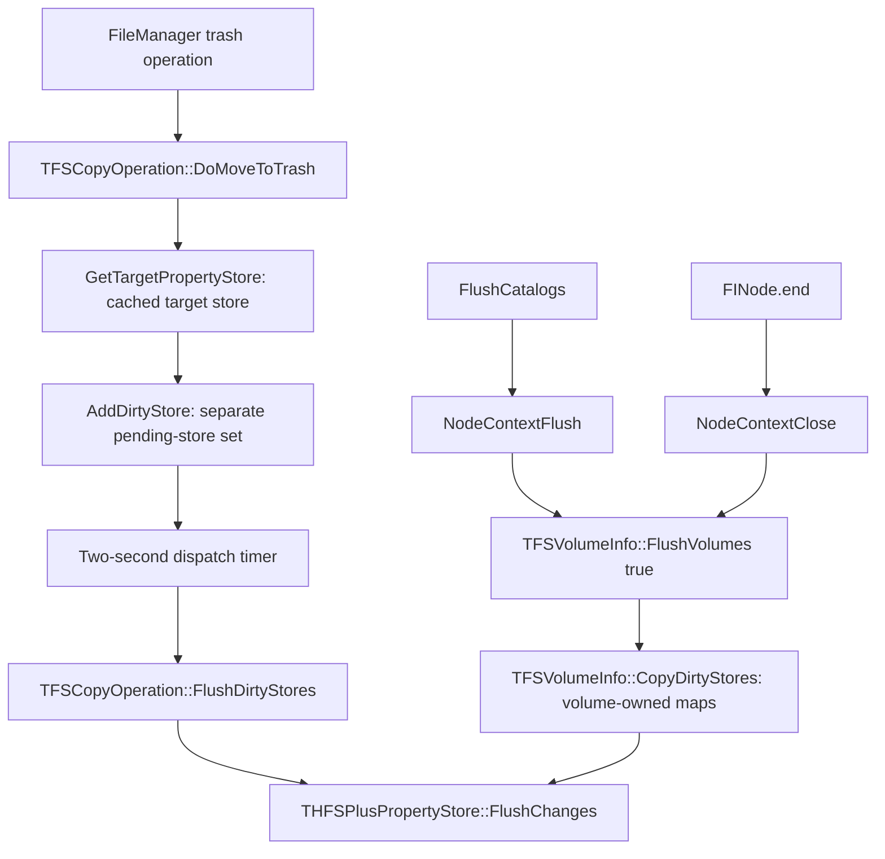

# Adjacent APIs around the delayed Put Back writer

On the inspected macOS build, **there are callable private flush functions, but
those functions do not drain the collection used by `FileManager` trashing**.
Calling the internal trash-specific flush from LLDB did write the missing
records immediately. Its implementation is coupled to its timer and is not a
standalone flush API.

This investigation changed no production code. The executable probes only
trashed uniquely named, generated payloads; observation opened `.DS_Store`
read-only. All 45 payloads from the 15 trials were cleaned up after observation.

## Environment and method

- macOS 27.0.1, build 26A434, arm64; local APFS home Trash.
- `DesktopServicesPriv` UUID: `BAEDBF9E-E7D0-393F-8153-874EF71C15C0`.
- LLDB loaded the framework in our own process, captured its symbol table and
  `__text`, and disassembled the relevant functions.
- An ARM64 `b`/`bl` scan indexed direct inter-function branches across the
  framework's 2,284,596-byte `__text` section. It found one direct caller of
  `TFSCopyOperation::FlushDirtyStores`: the block used by the delayed timer.
  This does not exclude indirect calls or code elsewhere in macOS.
- Trial execution was serial. The observer checked both `ptbN` and `ptbL` against
  the generated file's original location, then observed for three seconds
  after process exit. This is a metadata check, not a manual Finder action.

## The two collections



The diagram shows the queued trash case. `AddDirtyStore` also has a synchronous
fast path when its set is empty and the preceding-add timestamp is at least two
seconds old. That accounts for the usual first-file-only result.

`FlushCatalogs` is a tail-call wrapper around `NodeContextFlush`, which calls
`TFSVolumeInfo::FlushVolumes(true)`. That enumerates volume objects and their
property-store maps. `TOperation::FlushAfterOperation` similarly calls
`TFSVolumeInfo::Flush(false)` for operation destinations.

By contrast, `TFSCopyOperation::GetTargetPropertyStore` maintains a separate,
process-global cached `shared_ptr`. `AddDirtyStore` keeps pending stores in a
separate global set. The trash-specific flush copies those pending stores,
marks the originals clean, clears the set, and flushes the copies outside the
collection lock. None of the inspected volume flush paths reads that set.

There really is a private lifecycle cleanup path:
`+[FINode end] → NodeContextClose → FlushVolumes(true)`, on final context close.
Its existence does not establish that ordinary AppKit termination calls it;
it also does not bridge the two collections in the inspected code.

## Callable candidates and experiments

Both `FlushCatalogs` and `NodeContextFlush` resolve with `dlsym` in our probe.
Their no-argument calling convention was inferred from this build's
instructions. Neither is a supported public API.

| Action after three successful trash moves | Trials | Complete records after exit |
| --- | ---: | --- |
| Immediate exit, no extra call | 3 | First file only, every trial |
| `FlushCatalogs()` then exit | 3 | First file only twice; none once |
| `NodeContextFlush()` then exit | 3 | First file only twice; none once |
| Keep the process alive for three seconds | 3 | All three, every trial |

The exported calls returned in approximately 1–2 microseconds. None recovered
complete metadata for either queued file, including the post-exit observation.
The occasional missing first record was also seen in earlier probes; this
experiment does not establish its cause.

Reproduce these twelve trials from the repository root:

```sh
uv run devdocs/probes/metadata-writer/run.py
```

The runner compiles [probe.m](probe.m), reuses the existing AppKit probe's
read-only observer and ownership-checked cleanup, and saves results under a
new `target/metadata-writer-probe-*` directory. The private ABI assumptions are
specific to the inspected system; review them before using another OS build.

## Calling the actual pending-store flush

`TFSCopyOperation::FlushDirtyStores()` is present in the local symbol table but
is not exported. Its mangled name,
`_ZN16TFSCopyOperation16FlushDirtyStoresEv`, returned null from `dlsym`.

In a separate debugger-controlled trial we stopped our process after three
moves, read the metadata, found the function's address through LLDB's loaded
symbol table, called it on the stopped main thread, and read the metadata again:

- Before: first file complete; second and third had no Put Back records.
- After: all three had the expected `ptbN` and `ptbL`.
- The debugger expression returned successfully; evaluation took about 27 ms,
  including debugger/JIT overhead. This is not a flush-performance benchmark.
- The process then exited normally; all records remained through the three-second
  observation. A matching debugger control without the call remained first-only.

An earlier forced-call trial also produced all three records and exited normally,
but LLDB's void-valued expression reported an unhelpful error. The final trial
used `(call(), 0)` and obtained an explicit successful expression result. There
were three debugger trials total: one control and two forced calls.

The implementation has a critical precondition: it dereferences the pending-set
pointer without a null check, and later clears that pointer. The timer event
handler cancels the timer *after* invoking the flush. Calling the flush directly
does not cancel the timer. From the inspected instructions, an early direct call
can therefore leave an armed callback that later dereferences a null pointer.
We exited promptly in the experiments and did not deliberately test that crash.
This is an implementation inference, not an observed crash report.

## Other clues

- `THFSPlusPropertyStore`'s C++ destructor calls `FlushChanges`. Releasing a
  `FileManager` or draining an Objective-C autorelease pool does not release the
  independent global C++ owners. The target cache and pending set are stored
  through heap-allocated global pointer holders in the inspected paths.
- The delay is a literal two seconds in `AddDirtyStore`; the inspected routine
  does not consult a preference or environment variable to choose it.
  The nearby `InitializeDebugFlags` block only checks `/tmp/OperationTimes` to
  enable diagnostic timing in this build.
- `GetTargetPropertyStore` first calls `_xpc_runtime_is_app_sandboxed` and returns
  an empty store when it reports true. That is a separate branch from the timing
  problem. Our probes were not App Sandbox applications; merely being a `.app`
  does not exercise that branch.

These findings support keeping trache's existing helper approach. We found no
supported callable route to synchronously drain this particular pending set.

## Local evidence

Raw captures are ignored build artifacts:

- `target/metadata-writer-analysis/symbols.json`, `sections.json`, `edges.json`,
  and `xrefs.txt`: framework symbols and direct branch relationships.
- `target/metadata-writer-analysis/candidate-disassembly.txt`: delayed writer,
  timer blocks, exported wrappers, and operation/volume flush candidates.
- `target/metadata-writer-analysis/extra-disassembly.txt`: volume collection,
  property-store destructor, trash operation, and node-context lifecycle.
- `target/metadata-writer-analysis/target-store.log`: target cache, debug flag
  initialization, and `dlsym` checks.
- `target/metadata-writer-analysis/resolved-stubs.log`: imported-call resolution.
- `target/metadata-writer-probe-1791770048403022000/`: twelve normal trials.
- `target/metadata-writer-analysis/debug-control-b5119b39f89d47de857020acb2e6f4e0/`:
  debugger control.
- `target/metadata-writer-analysis/debug-force-b6972d37ae1b41169ed7fc7226c4aeaf/`:
  first forced call, with ambiguous void-expression status.
- `target/metadata-writer-analysis/debug-force-67f546e3f947491c805f768f09c9ae8d/`:
  successful integer-valued expression, before/after metadata, and normal exit.

Recorded load addresses are specific to this boot; they must not be hardcoded
into an executable. These observations are specific to the named framework
build, not a claim about all macOS versions or Finder's own implementation.
